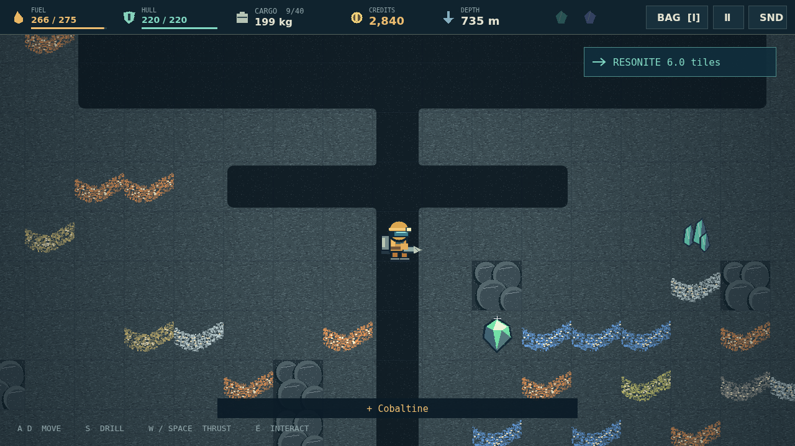

# The only way out is down.

You are a lone prospector stranded on a dead mining world. Above you: a scrapped camp and an unfinished escape rocket. Below you: a planet full of the things you need to leave. Deepcore is a dig-and-build expedition where every shaft is a promise that you can still make it home.

Bore through warm soil into cold rock, follow mineral veins, and fill your cargo bay. Then turn around. Falling is free; climbing costs fuel. A rich haul weighs down your jetpack, and the most valuable ore may be the piece you have to throw away. Sell what you bring back, repair the damage, and choose between a stronger suit and another piece of your rocket.

The deeper bands have their own warnings: a pale wisp from a gas pocket, the glow of molten rock, a shaft too long to fall safely. Carry explosives, emergency supplies, or a way back to camp. Upgrade your scanner to hunt the two rare crystals your escape needs.

At the bottom waits the Core. Extract a Sample and the clock starts. Ninety seconds to climb, cross the camp, and install the final component. Build your way out across a quick descent or a marathon mine, with a saved expedition to fall back on—or a Hardcore run with no second chance after death.

